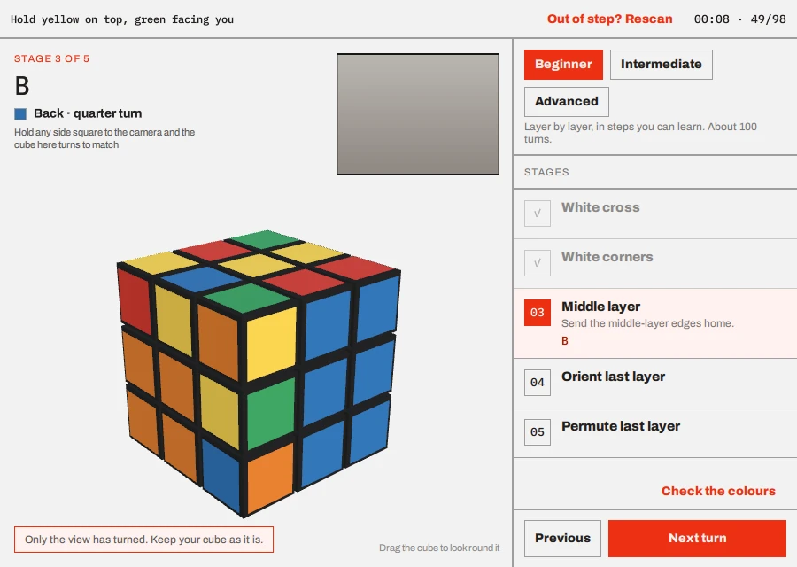
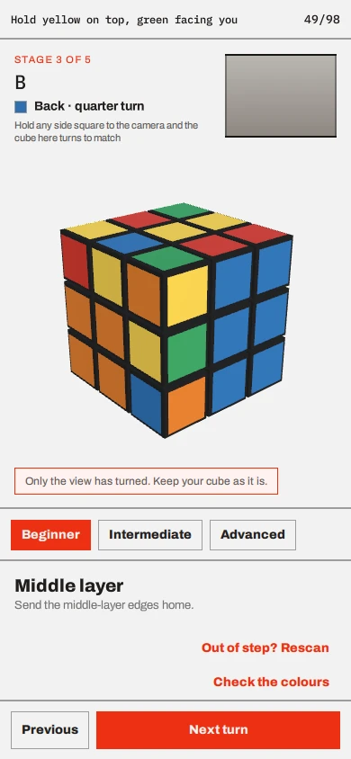
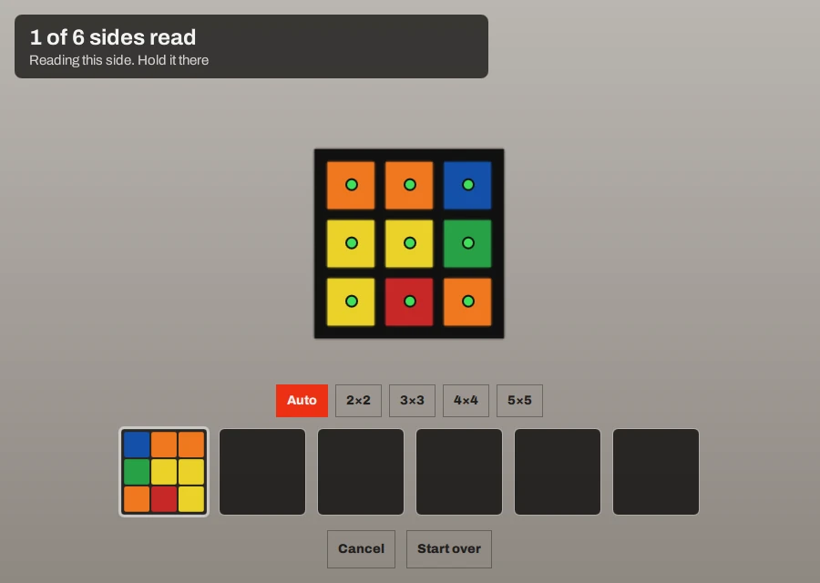
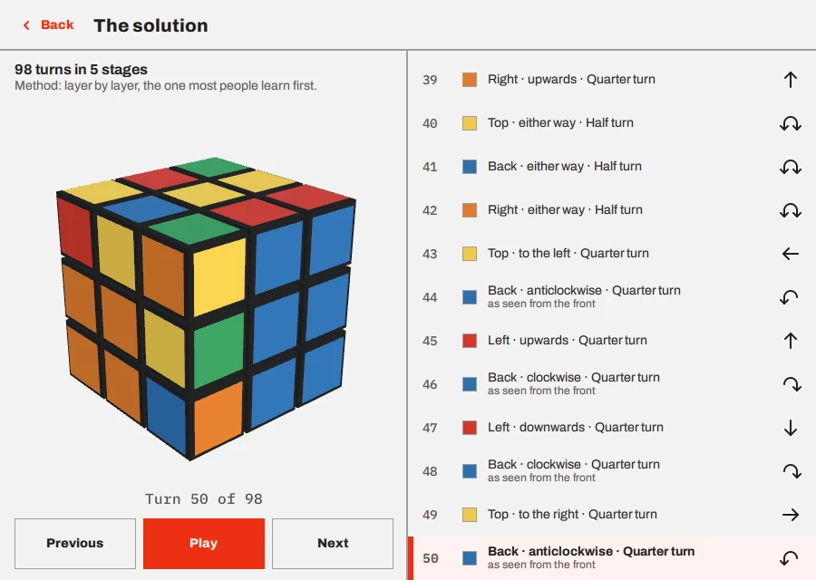
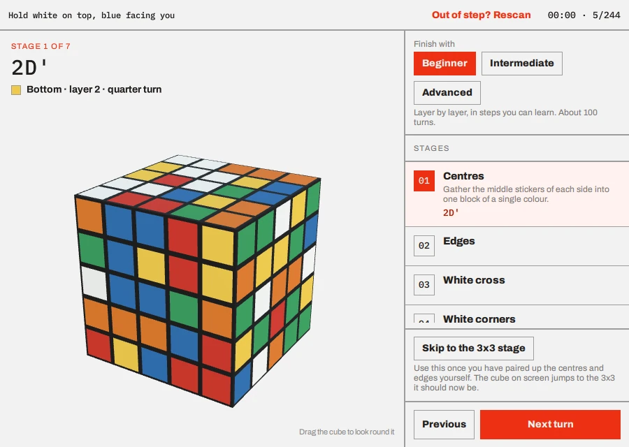
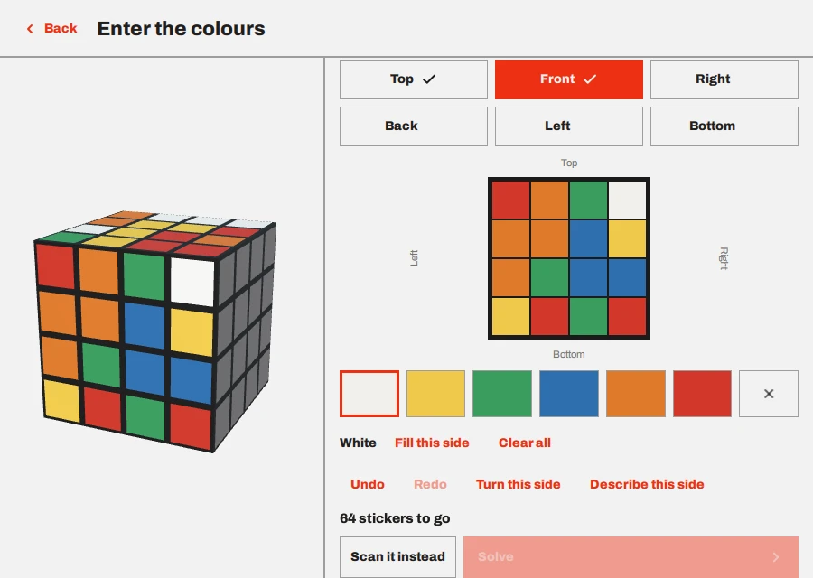

<section class="icl-hero icl-hero--app">

<h1>Cubeulator</h1>

Hold each side of a scrambled Rubik's Cube up to your camera. Cubeulator reads the whole cube, works out a solution and shows you the turns, one at a time, on a 3D cube.

<a class="icl-button" href="#download">Get Cubeulator</a>
<a class="icl-button icl-button--ghost" href="app/">Try it in your browser</a>

<ul class="cu-platforms" aria-label="Where Cubeulator runs">
<li><strong>Windows, macOS and Linux</strong>Download from GitHub, pre-release</li>
<li><strong>In a browser</strong>Nothing to install</li>
<li><strong>iPhone</strong>TestFlight, for invited testers only</li>
</ul>

No account &middot; Nothing uploaded &middot; Works offline on a computer &middot; English, with eight more languages in draft

<figure class="cu-window"><picture><source srcset="guide/img/solve-middle-wide-dark.webp" media="(prefers-color-scheme: dark)"></picture></figure>
<figure class="icl-device"></figure>

</section>

<section class="icl-section" id="how">

<h2>Scan, solve, follow</h2>
<ol class="cu-steps">
<li><h3>Scan</h3>
Show each side of the cube to the camera, in any order and either way up. Each side is recognised by the colour of its centre, which never moves. Six sides that make exactly one cube that can exist are a scan.
</li>
<li><h3>Solve</h3>
Pick how you want it solved: <em>Beginner</em> (layer by layer, about 100 turns), <em>Intermediate</em> (the method fast solvers use, about 50) or <em>Advanced</em> (the fewest turns, about 20).
</li>
<li><h3>Follow</h3>
The layer to turn nudges the way it has to go on a 3D cube, and the screen says it in words as well. Turn yours, and press Next. The camera stays on, so it can see your turn and step on by itself.
</li>
</ol>

<a href="guide/">Read the user guide</a>, or see <a href="guide/how-it-works/">how it works</a> in a little more detail.

</section>

<section class="icl-section icl-section--tint" id="features">

<h2>What it does</h2>
<ul class="icl-points">
<li><h3>Reads a real cube</h3>
It finds the nine stickers of each side and names them from what the camera sees. A sticker it read wrongly is put right by hand on the colours screen, without scanning again.
</li>
<li><h3>Three ways to solve it</h3>
Change method at any moment, even half-way. The cube is solved from where it stands now.
</li>
<li><h3>A 2&times;2 up to a 5&times;5</h3>
Scan it, or type the scramble or the colours in, and follow it on a 3D cube drawn at its size.
</li>
<li><h3>Follows your turns</h3>
Make the turn asked for in view of the camera and the solution steps on by itself. It never moves on while the cube and the solution disagree.
</li>
<li><h3>Private by design</h3>
The camera picture is read on your device and dropped. There is no account, no telemetry and no update check, and the app's own code makes no network calls.
</li>
<li><h3>Free software</h3>
The source is on GitHub under the GNU General Public License. Each release has signatures, build attestations and bills of materials.
</li>
</ul>

<a href="features/">All the features</a>

</section>

<section class="icl-section" id="screens">

<h2>A look at it</h2>

These are pictures of the app itself, taken by its own test suite. The camera picture in them is a drawn frame, so nobody is in them.

<figure>

<figcaption>Scanning. A dot sits on each sticker it found, and a chip fills as a side is read.</figcaption></figure>
<figure>
<picture><source srcset="guide/img/solution-middle-wide-dark.webp" media="(prefers-color-scheme: dark)"></picture>
<figcaption>The whole solution, grouped by stage, to look back over.</figcaption></figure>
<figure>
<picture><source srcset="guide/img/solve-big-middle-wide-dark.webp" media="(prefers-color-scheme: dark)"></picture>
<figcaption>A 5&times;5. A layer inside the cube is named from the side it is counted from.</figcaption></figure>
<figure>

<figcaption>Putting right a sticker the camera misread, or typing a cube in.</figcaption></figure>

The start screen, <a href="guide/scan/">scanning</a> and <a href="guide/settings/">settings</a> are in the <a href="guide/">user guide</a>, in light and dark.

</section>

<section class="icl-section icl-section--tint" id="download">

<h2>Get Cubeulator</h2>
<ul class="cu-platform-cards">
<li>

Pre-release

<h3>Windows, macOS and Linux</h3>

An installer for each, on GitHub: Windows 10 or later (64-bit), macOS 14.4 or later on Apple silicon, and Debian, Ubuntu or Fedora. They are not signed with a Windows or Apple certificate yet, so each system asks before it runs one. Every file can be <a href="guide/verify/">checked</a>.

<a class="icl-button" href="https://github.com/iainchesworthlabs/cubeulator/releases">Packages on GitHub</a>
</li>
<li>

Nothing to install

<h3>In a browser</h3>

The same app, as WebAssembly, in a current Chrome, Edge, Firefox or Safari. It needs a camera and a secure page, which this is. It runs on your device; nothing is sent anywhere.

<a class="icl-button" href="app/">Open Cubeulator</a>
</li>
<li>

Invited testers

<h3>iPhone</h3>

The iPhone app goes to TestFlight for testers the author has invited. It is not in the App Store, and there is no public test link. It needs iOS 18 or later. Everyone else can use the browser version on a phone.

<a class="icl-button icl-button--ghost" href="guide/iphone/">About the iPhone build</a>
</li>
</ul>

Android: the app builds for Android, but its camera is not written yet, so it cannot scan and is not offered.

It is pre-release software. The scan has been checked on recorded sessions and on a webcam, not yet across many cameras, rooms and cubes. <a href="whats-new/">What's new</a> says what each release changed and what is not yet proven.

</section>
